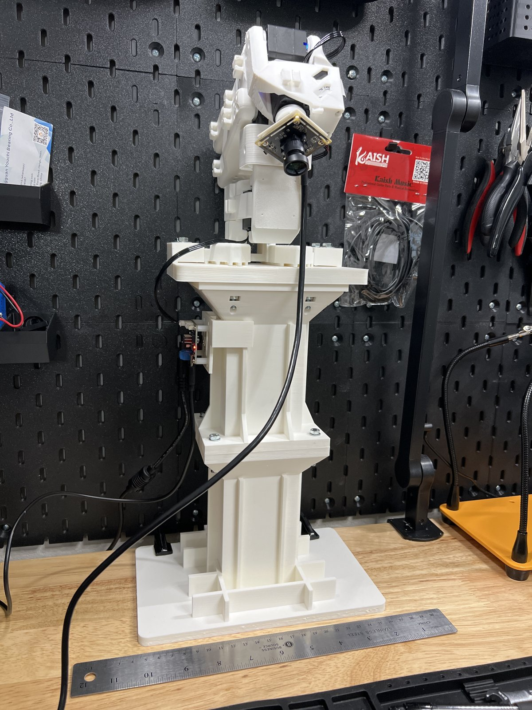
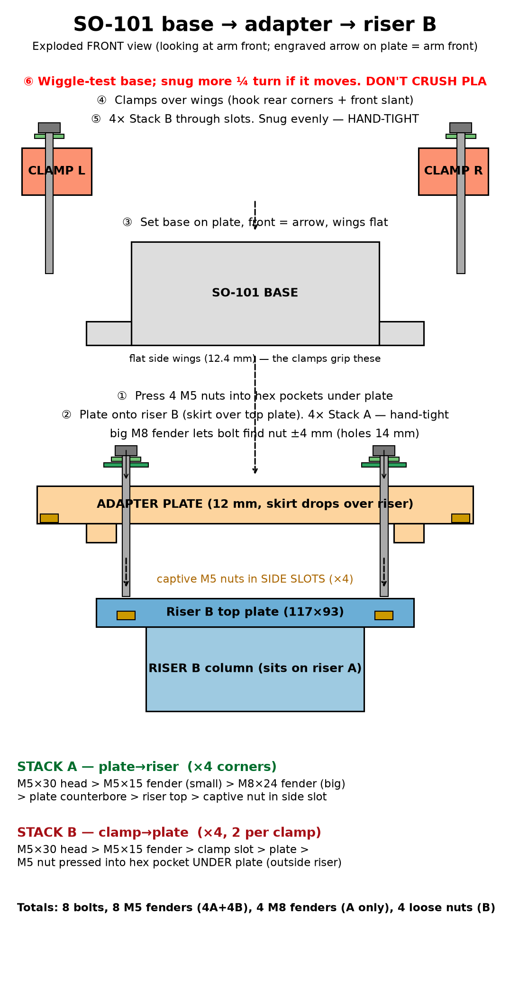
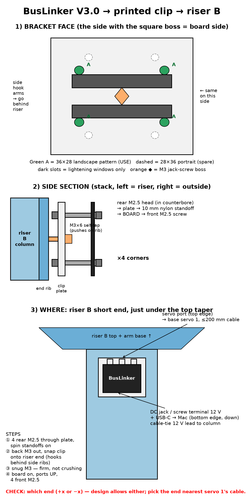

# Agent Vision

<p align="center"></p>

An AI-controlled camera arm built on the open SO-101.

Agent Vision is a five-servo SO-101 arm with the gripper swapped for a small camera plate, mounted on a printed riser at the back of a workbench. An AI assistant drives it from a computer over USB, so it can move the camera above a spot on the bench and then aim it precisely.

This is my first public repo, and I'm new to robotics, so the docs are written for beginners.

**Goal of this repo: tools, not numbers.** Every bench, riser and cable run is different, so you discover your own joint limits and teach your own camera presets. Nothing here ships one person's positions for you to reuse.

## What's in here

| Path | What it is |
|---|---|
| `agent_vision/` | Python package: `hx_bus` servo driver plus the `av_*` command line tools. |
| `tests/` | Unit tests for packet building/parsing, checksums and clamping (no hardware needed). |
| `examples/` | Placeholder `limits`, `poses` and `av_config` files showing the file format only. |
| `cad/stl/` | Printable parts: riser v2 (A foot, B top), arm adapter v2 (plate + left/right clamps), BusLinker mount, camera plate v3 rev c. See [HARDWARE.md](HARDWARE.md). |
| `cad/*.py` | CadQuery sources for those parts. `arm_adapter_v2.py` needs a base outline traced from Hiwonder's base part, which is not included. |
| `HARDWARE.md` | Full bill of materials: electronics, printed parts, every screw, nut, washer and standoff, print settings. |
| `tools/build_explainer_glb.py` | Rebuilds the explainer's 3D model from the CAD exports and re-embeds it in `docs/index.html`. |
| `models/so101-camera-arm.glb` | The assembled arm, riser and camera plate as one 3D model. |
| `docs/index.html` | "How Agent Vision works", an interactive 3D explainer (also served on GitHub Pages). |
| `docs/buslinker.html` | How the BusLinker board connects the computer, the 12 V supply and a chain of bus servos. |

## Parts list

The full list with every fastener by size and count is in **[HARDWARE.md](HARDWARE.md)**. In short:


- Hiwonder SO-ARM101 kit (follower arm): 5 HX bus servos used, BusLinker V3.0 board, 12 V supply, bus cables and kit hardware. The gripper servo and jaws are not used.
- UC-A55 / Arducam USB camera board for the wrist.
- **4-pin camera-to-USB cable.** The camera board may ship without one that reaches from the wrist to your computer; you may need to buy it separately. Leave slack through every joint.
- USB cable from the BusLinker to your computer.
- Printed parts: riser foot, riser top, camera plate, arm adapter, BusLinker mount. These use only SO-101 kit hardware, plus the bench fasteners for the riser (M5 bolts and washers into the riser's captive nuts, and a clamp to the bench edge).

## Assembly

1. Get the Hiwonder SO-ARM101 kit and print its follower-arm parts (skip the gripper jaws).
2. Give each servo its own ID, one servo on the BusLinker at a time: 1 base, 2 shoulder, 3 elbow, 4 wrist, 5 wrist roll.
3. Assemble the arm from the base up. Toothed "main" horns clamp onto the splined servo shafts with the center screw; smooth "assistant" horns go on the back pivots.
4. Print the parts in `cad/stl/`. Stack riser B on riser A (A's spigot goes into B's socket) and bolt them together. Bolt the adapter plate onto riser B's top, set the arm base on it, and strap it down with the two clamps (no drilling). Then clamp the foot to the bench. Always clamp it; weight alone won't stop a swinging arm from tipping.



5. Clip the BusLinker mount onto the riser column and fit the board.



6. Fit the camera plate (v3 rev c) to the wrist-roll horn with the 4 kit M3x6 screws, then screw the camera board onto its 4 printed corner posts. The plate's 4 mm boss lifts it clear of the wrist bracket's small tab.

## Wiring

```
computer --USB-- BusLinker V3 --bus--> 1 base --> 2 shoulder --> 3 elbow --> 4 wrist --> 5 roll
                     ^
                   12 V
computer --USB (4-pin cable)-- wrist camera
```

Daisy-chain the bus cables from the BusLinker to the base, then each servo up to the wrist roll, leaving slack at each joint. The servos talk at 1,000,000 baud. See `docs/buslinker.html` for a picture of the board.

## Setup

```bash
python3 -m venv .venv && source .venv/bin/activate
pip install -e .
# macOS camera snaps need ffmpeg: brew install ffmpeg   (Linux: apt install ffmpeg)
```

Find your serial port (macOS: `ls /dev/cu.usb*`, Linux: `ls /dev/ttyUSB* /dev/ttyACM*`) and tell the tools about it, in any of these ways (first one wins):

- `--port /dev/cu.usbmodemXXXX` on each command
- `export AV_PORT=/dev/cu.usbmodemXXXX`
- `cp examples/av_config.example.json av_config.json` and edit `port`

Check the bus:

```bash
av_read     # position (0-1000), temperature and voltage for joints 1-5
```

## Discover your ranges

Your safe range depends on your riser, bench, cable runs and what is nearby. Capture it once, by hand:

1. Clear the space around the arm. Support the arm with one hand.
2. Run `av_capture_range` (add `--margin 40` for a bigger safety margin; the default is 25). Torque goes off.
3. Slowly move **each** joint to both ends of its travel. Stop at resistance, a cable tug, or anything the arm or camera could touch.
4. Press Ctrl-C. The tool trims the margin off each end and writes `limits.json`.
5. Leave the arm resting folded; torque is still off.

`av_goto` refuses to move without `limits.json` and clamps every target to it. Re-run the capture whenever you change the mount, cables or surroundings.

## Teaching presets

```bash
av_teach overhead --snap     # torque off, place the arm, press Enter, it locks and saves
av_relax                     # torque off again (support the arm first)
av_goto overhead             # slow move back to the saved pose
av_snap                      # grab a frame into frames/
```

`av_teach` reads all five positions, re-locks the joints in place, optionally saves a camera frame to `frames/NAME.jpg`, and stores the pose in `poses.json`. A suggested starter set:

| Name | What it's for |
|---|---|
| `home` | Folded rest pose; the safest place to relax torque. |
| `overhead` | Camera straight down over the middle of the work area. |
| `front45` | Looking at the work area from the front at about 45 degrees. |
| `side_low` | Low side view for checking heights and edges. |
| `detail` | Close-up on a small spot. |
| `face_user` | Camera facing you, for a call or a quick check-in. |

`av_goto` options: `--max-temp 55` (abort and hold if any servo goes hotter, in C), `--step 20` and `--step-ms 100` (smaller step or longer time = slower).

## Safety

- **Support the arm before torque off.** `av_relax`, `av_capture_range` and `av_teach` make the arm go limp; it will drop under its own weight.
- **Gravity sag.** With torque on, the shoulder and elbow sag a little under load, more at full reach. Leave clearance, and don't teach poses that touch anything.
- **Stay in your limits.** Only move with `av_goto`, which clamps to `limits.json`. Re-capture limits after any change.
- Watch temperatures with `av_read`. Let hot servos cool and don't hold the arm stretched out for long.
- Keep hands, cables and faces clear when it moves, and keep the riser clamped.

## Known gaps (please check before you print)

- **Arm base clamps.** The v2 adapter uses no base holes; two strap clamps grip the base's side wings. Their fit was designed from the base mesh: about 110.9 mm across the wings and 12.4 mm wing thickness. The clamps only adjust about ±1.75 mm front to back. Measure your base with calipers, and print one clamp first to test it before the large plate.

## Credits

This project stands on other people's open work. Thank you.

- **[TheRobotStudio](https://github.com/TheRobotStudio/SO-ARM100)** designed the SO-101 arm (Apache License 2.0). The 3D explainer uses their arm meshes and URDF joint data, converted and restyled. See [NOTICE](NOTICE) for exactly what was changed.
- **Hiwonder** makes the SO-ARM101 kit I built from: the HX-30HM bus servos, the BusLinker V3.0 board, and the print files for their servo pockets. Their print files are **not** copied here; get them from Hiwonder with the kit. <!-- TODO(Josh): add the Hiwonder product/download link -->
- **[LeRobot](https://github.com/huggingface/lerobot)** by Hugging Face is the open robot-learning project the SO-101 was designed for.
- **[Anatomy](https://github.com/wheresryan22/anatomy)** set the conventions for the explainer pages.
- **[ISO-GLOW](https://isoglow.dev)** by April Zhu (MIT) provides the 3D page shell, built on **[iso-figure](https://github.com/MrBongoC/ai-iso-skill)** by Tolga Cohce (MIT).
- **[three.js](https://threejs.org)** (MIT) renders the 3D view.

## License

Apache License 2.0, the same license as the SO-101. See [LICENSE](LICENSE) and [NOTICE](NOTICE).
